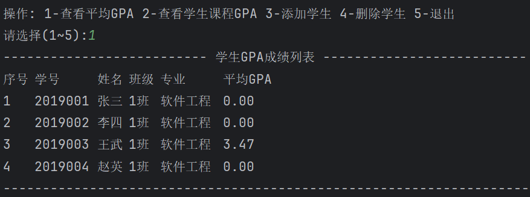
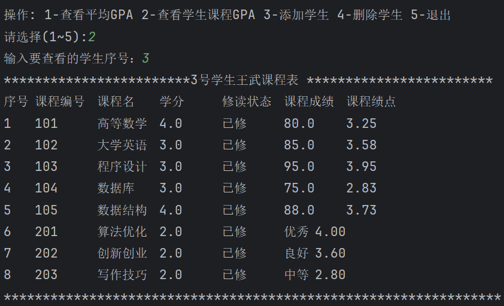

# StudentGPASystem
Java SE 控制台学生GPA绩点管理系统，采用分层架构，面向对象编程，通过继承区分必修课程与选修课程。

## 📦 项目结构
src/

└── szpt.gpa

├── domain        // 实体层

│   ├── Student.java

│   ├── Course.java

│   ├── RequiredCourse.java  // 必修课程，继承 Course

│   └── ElectiveCourse.java  // 选修课程，继承 Course

├── service       // 业务逻辑层

│   └── StudentListService.java

├── view          // 视图与输入输出工具

│   ├── SysMenuView.java

│   └── IOUtil.java

└── Main.java     // 程序入口

## ✨ 功能
- 学生信息添加、删除
- 展示全部学生GPA列表，自动加权计算平均GPA
- 查询单个学生课程明细，区分必修、选修
- 课程成绩录入、修改，自动换算课程绩点
- 两级菜单交互，控制台格式化表格打印

## 🛠 技术
Java SE、面向对象、继承多态、分层设计、ArrayList、控制台IO

## 🚀 运行
1. IDEA导入项目
2. 运行 `szpt.gpa.Main`
3. 根据控制台提示输入数字选择功能

## 📸 截图

